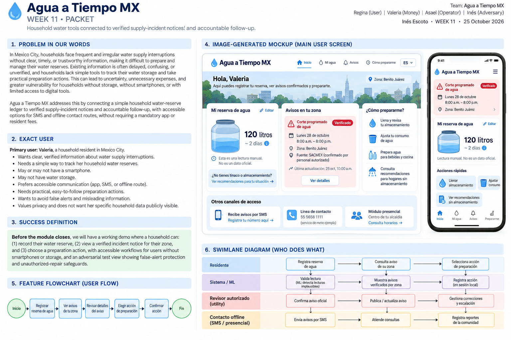
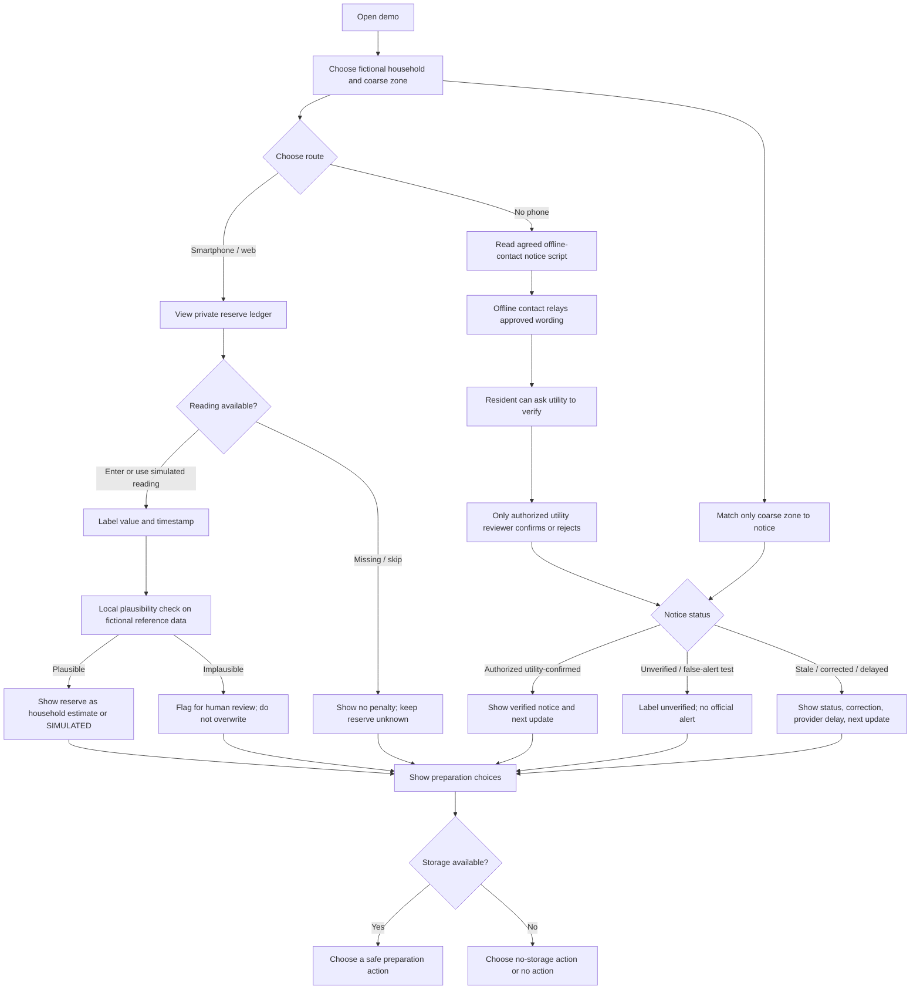
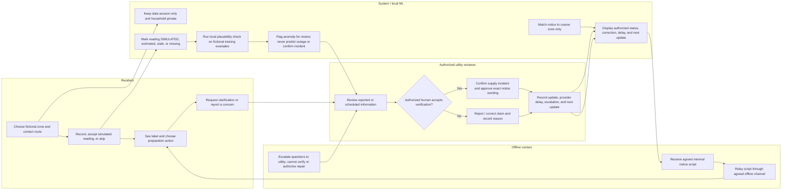

# Agua a Tiempo MX — Project Packet

**Project role:** Inés — Adversary  
**Status:** Phase 1 packet only. No application code, services, accounts, or deployments have been created.

## 1. Problem in our own words

Households need a trustworthy, understandable way to know what water they have available at home, prepare for a supply interruption, and get accountable updates without paying a fee or being required to own a smartphone. A reserve estimate is not an official incident notice: simulated or stale readings must be labeled, and only an authorized utility human may confirm a supply incident. The demonstration must also make false alerts, missing readings, households without storage, and unauthorized repair activity safe to encounter rather than quietly assuming them away.

## 2. Exact user

The primary user is an adult resident of one of 100 fictional pilot households in a participating Mexican utility's coarse service zone, including residents who use SMS or an agreed offline contact route instead of a smartphone. The resident may or may not have a water-storage container and may not submit readings. A secondary user is an authorized utility reviewer who verifies incident notices and escalation status; an offline contact helps relay a notice but cannot confirm an incident or authorize work.

## 3. Success definition

Before the module closes, a resident using the demonstration can record or skip a reserve reading, see whether it is simulated or estimated, inspect a verified incident notice that is explicitly tied to their coarse zone, and choose a practical preparation action—including an option for no storage and a no-phone route—without seeing another household's data. An adversarial reviewer can trigger an implausible-reading review, simulate a false alert, and verify that neither an unverified alert nor a resident/offline contact can confirm an incident, authorize a public-network repair, or cause spending. In any later real pilot, report denominators and evaluate false alarms, comprehension, preparation among able households, exclusion, costs, and scheduled-notice lead time; no real events means results are inconclusive, not proof of impact.

**Pilot targets, not achieved results:** at least 90% of eligible scheduled notices delivered at least 12 hours early; at least 80% comprehension; and at least 70% preparation among households able to prepare. Always publish numerator and denominator, eligibility definition, missingness, and event count.

## 4. Screen mockup

## 5. Feature flowchart

## 6. Resident-to-utility swimlane

## 7. Benchmark and localization

| Reference | Relevant approach | What Agua a Tiempo MX borrows—and does not claim |
|---|---|---|
| [PUB Smart Water Meter (Singapore)](https://www.pub.gov.sg/) | A utility-led smart-meter reference for making household water-use information more visible. | Use the general idea of timely, understandable water information. This demo uses fictional, simulated reserve readings; it is not a PUB deployment, a meter integration, or evidence that a similar service will work in Mexico. |
| [WINT](https://wint.ai/) | Water monitoring and leak-detection reference for building water systems. | Use anomaly detection as a prompt for investigation, not as authority. The planned local model checks whether a household reserve reading looks implausible; it does not detect municipal leaks, forecast outages, or dispatch repairs. |

**Localization:** Adapt the communication and governance to the participating Mexican utility and its service zones: Spanish-first plain language, locally agreed SMS and offline contact routes, coarse-zone notice matching, human utility confirmation, and explicit correction/provider-delay updates. Household reserve status remains distinct from public-network incident status. These references are examples, not a ranking of globally best solutions, and the proposed pilot has not demonstrated impact.

## 8. Long-view charter

In three years, Agua a Tiempo MX could help participating utilities and residents exchange timely, understandable water-supply information through digital and offline channels. It could combine private household reserve records, carefully labeled readings, and utility-confirmed zone notices while leaving incident authority and repair decisions with accountable people. Its continued use would depend on demonstrated comprehension, equitable reach, privacy, reliable notice performance, and transparent costs rather than unvalidated forecasts or household penalties.

## 9. Explicit scope cuts

- No paid household repair membership, resident fee, pooled repair coverage, or household penalty.
- No real utility, sensor, SMS, map, payment, identity, or notification integrations in the demonstration.
- No real personal records, precise household coordinates, public household map, or cross-household view.
- No municipal outage prediction, AI-generated cause/restoration/quality claims, or automated official alert.
- No diagnosis of household plumbing, public-network repair dispatch, repair approval, or spending.
- No production backend, authentication, database, analytics, accounts, secrets, API keys, or persistent storage.
- No claim that synthetic tests establish real-world efficacy; no pilot-impact claim when there are no real events.
- No extra features, packages, infrastructure, or deployment during this packet phase.

## 10. Architecture and technology stack

| Layer | Later demonstration choice | Boundaries |
|---|---|---|
| UI | Free Vite + React + TypeScript | Small responsive interface with accessible labels, keyboard operation, and plain-language status text. |
| Styling | Native CSS | No UI framework or paid design dependency required. |
| Reserve ledger | In-memory session state | Fictional household records only; reset on reload/session end; no server persistence. |
| IoT / sensing | Simulated water-level readings | Prominently label every generated sensor value **SIMULATED**, with timestamp and fictional source. Never imply a connected sensor. |
| ML | Local k-nearest-neighbor novelty check over fictional reference readings | Compare normalized reserve percentage and change-rate features against fictional training examples; flag an outlier for human review. No external AI, outage prediction, or incident authority. |
| Geodata | Static coarse-zone identifiers | Match a fictional notice to a zone only; do not collect or display household coordinates or household locations. |
| Notice authority | Local fictional scenario state | Only an explicitly designated authorized utility reviewer action can mark an incident verified; scenario controls cannot impersonate a real utility event. |
| Testing | Existing project scripts, when available; manual adversarial checks | Test visible labels, decision gates, and accessible no-phone/no-storage flows. No tooling setup in this phase. |
| Hosting | Vercel, only in the later build roadmap | Two planned deployments for the demo; no deployment or account setup now. |

## 11. Mechanical and adversarial test plan

All tests use invented records and controlled scenarios. Later report counts and denominators; where an outcome needs a real interruption, mark it inconclusive rather than passing it using a simulation.

| Test | Adversarial setup | Expected result / evidence |
|---|---|---|
| No-phone access | Use the offline route without opening the web ledger. | Agreed offline contact can relay minimal approved wording; no smartphone/app is required for basic notice access; resident can get a next-update route. |
| No storage | Choose a household with no container. | Offer a practical no-storage action or no-action choice; do not shame, score, or classify the household as unprepared. |
| Missing readings | Skip all readings, then provide a stale/missing reading. | Reserve remains unknown or explicitly stale; no inferred value, penalty, false certainty, or broken notice access. |
| Simulated sensing | Trigger a simulated water-level value. | Every view labels it **SIMULATED**, shows its time/context, and distinguishes it from a household estimate and verified public notice. |
| False alert | Create a plausible-looking but unverified outage claim and a wrong-zone claim. | Neither becomes official; show unverified/wrong-zone state and route to authorized human review; no invented cause, restoration time, or quality claim. |
| Authorized confirmation | Have a non-authorized resident or offline contact attempt to confirm an incident. | The action is unavailable or rejected; only the authorized utility reviewer can confirm, with a recorded status and next update. |
| Corrections and delays | Correct a notice and simulate a provider delay. | Preserve visible correction/status history, identify the delay, and show the next-update commitment; never leave stale information looking current. |
| Unauthorized repair | Resident, anomaly model, or offline contact requests a household or public-network repair/spending without accepted utility verification and escalation. | No repair is dispatched or paid; distinguish household plumbing from public network and require the utility's accepted verification/escalation process before any field spending. No pooled coverage. |
| Privacy | Inspect all screens and attempt cross-household access/aggregation. | No public household map or other household's record; no real identifying data; aggregation absent unless explicit consent is designed and obtained. |
| Coarse zone | Inspect zone matching and notice display. | Only coarse fictional zone is used; no precise household location is requested, stored, or rendered. |
| Plausibility model | Supply fictional in-range and implausible jumps, including boundary values. | Local kNN check flags implausible records for human review without silently changing the ledger or generating a municipal alert; explain the flag and retain the original demo value. |
| Scheduled-notice evaluation | For any later real events, calculate lead time only for eligible scheduled notices. | Report numerator/denominator against the >=90% at-least-12-hours target; label zero real events inconclusive. |
| Comprehension/preparation/equity | Ask test residents to explain status and select action; include no-phone/no-storage personas. | Report comprehension denominator against >=80%, preparation among able households against >=70%, exclusions, missing responses, and actual costs; do not count unable/no-storage households as failures. |

## 12. Security-floor plan

- **Secrets:** No API keys, credentials, or secrets are required or permitted for this fictional, client-only demo. Do not place secrets in source, browser storage, or environment files.
- **Authentication condition:** No authentication is needed only while records are invented, session-only, and there are no real users or privileged remote actions. Before introducing real personal data, persistent/shared access, or any operational utility action, require an approved identity/access design, role separation, and security review; utility incident confirmation must remain restricted to authorized humans.
- **Database / RLS condition:** The demo has no database. If persistence or a hosted database is later proposed, stop and design data minimization, consent, retention/deletion, access controls, and row-level security (RLS) before connecting it; enforce tenant/household isolation server-side and test it. Client-side filtering is not authorization.
- **Validation:** Validate scenario identifiers, coarse zones, numeric reserve values, capacities, timestamps, and status transitions at the UI boundary; reject non-finite/negative/out-of-range values and impossible transitions with a clear message. Treat all user-entered text as untrusted and render as text, not executable markup.
- **Fictional demo records:** Use obviously synthetic household labels, contact routes, readings, notices, and utility reviewers. Never solicit or import real names, phone numbers, addresses, exact locations, account numbers, health information, or actual household reserve data.
- **Operational safety:** Demo state cannot call a utility, contact a resident, publish an alert, create a work order, authorize a repair, or cause spending. Clearly label simulated scenarios; provide correction and stale-status affordances.

## 13. Blueprint conditions and shadow-clause compliance

The following conditions govern both this packet and any later implementation; no demo shortcut may silently weaken them.

| Blueprint condition | Compliance rule for the slice |
|---|---|
| Utility-funded pilot; no paid household repair membership | No resident fee, mandatory app for basic notices, pooled repair coverage, or household repair-membership framing. |
| SMS and offline access | Plan an SMS route and an agreed offline contact route; neither requires a smartphone. Actual sending is out of scope. |
| Evidence/status distinctions | Clearly separate estimates, **SIMULATED** sensor readings, stale/missing data, unverified claims, and utility-verified information. |
| Incident authority and claims | Only an authorized human can confirm an official supply incident. Never invent cause, restoration date, water-quality claim, or an AI forecast. |
| Repair and spending gate | Do not spend in the demo. Any future field spending requires accepted utility verification and escalation; distinguish private household plumbing from public network work; no pooled coverage. |
| Notice accountability | Target at least 12 hours' notice for scheduled interruptions. Log updates, corrections, provider delays, and next update. |
| Household privacy | Private by default, no public household map, no penalty for missing readings. Aggregation only with consent. |
| Evaluation honesty | Evaluate false alarms, preparation, exclusion, and actual costs. Report denominators for the 90%/80%/70% targets. No real events means inconclusive. |
| Pilot design status | 100 households, three months, MX$15,000 cap, and 70% fixed / 30% quality-linked payment are an unvalidated design budget and payment proposal—not proven impact, secured funding, or guaranteed payment. |
| Adversary responsibility | Explicitly exercise false alerts, households without phones, households without storage, missing readings, unauthorized repairs, and exclusion risks. |

**Shadow-clause check:** No additional or hidden exception is assumed. Any later request that conflicts with these conditions—especially resident charges, mandatory app use, unverified alerting, household penalties, location exposure, or unapproved repair spending—must be treated as out of scope until the team explicitly revises and documents the blueprint.

## 14. Later implementation roadmap (not authorized in this phase)

This sequence is a future work plan, not work performed. Each commit should be small, reviewable, and limited to the demonstration.

1. **Commit 1 — Scaffold the Vite/React/TypeScript demo:** establish only the minimal free client-side app and run it locally; no backend or deployment.
2. **Commit 2 — Add fictional reserve ledger and status labels:** in-memory session data, missing/stale states, and explicit simulated-reading labels.
3. **Commit 3 — Add coarse-zone verified-incident workflow:** authorized-reviewer gate, corrections, provider delays, and next-update history.
4. **Commit 4 — Add accessible preparation and contact routes:** no-phone/offline and no-storage workflows, keyboard and screen-reader checks.
5. **Commit 5 — Add local fictional-data plausibility model and adversarial test view:** anomaly flags only, with no official alert/repair side effects.
6. **Commit 6 — Mechanical test, bug-fix, redeploy cycle:** run the written test plan, fix observed mechanical failures, rerun those tests, then make the second deployment. Do not call a deployment verified until its deployed behavior is checked.
7. **Commit 7 — Synthetic persona screenshot test and improvement:** capture a screenshot of the running demo, have a synthetic no-phone/no-storage persona evaluate comprehension and next steps from that screenshot, record observed friction, make a focused UI improvement, and capture/recheck the improved screen.
8. **Session close — record decisions:** create/update `DECISIONS.md` with the scope decisions, test and denominator results, remaining risks, deployment URLs/status, screenshot/persona findings, and explicit unresolved items before closing the implementation session.

**Deployment checkpoints:** make the first Vercel deployment only after the first coherent demo slice (after Commit 3) and review it; make the second only after the mechanical bug-fix-and-retest cycle (Commit 6). Deployment is optional if the free account/permissions are unavailable; do not add paid services or credentials to satisfy the roadmap. No deployments are made during this packet phase.
