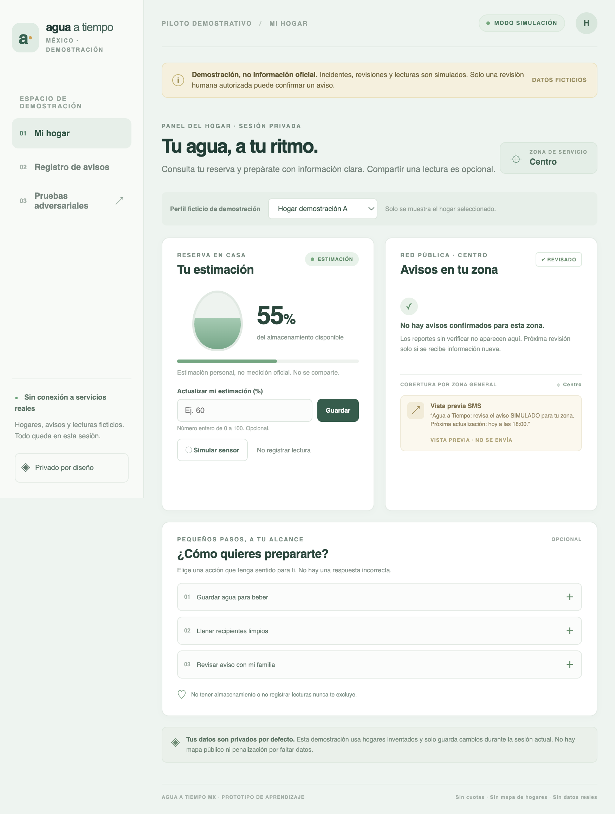
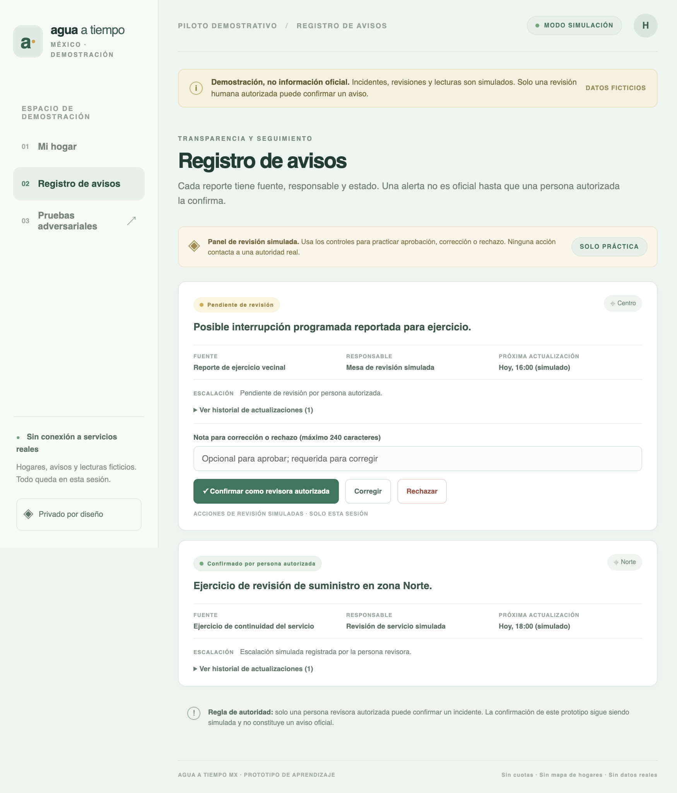
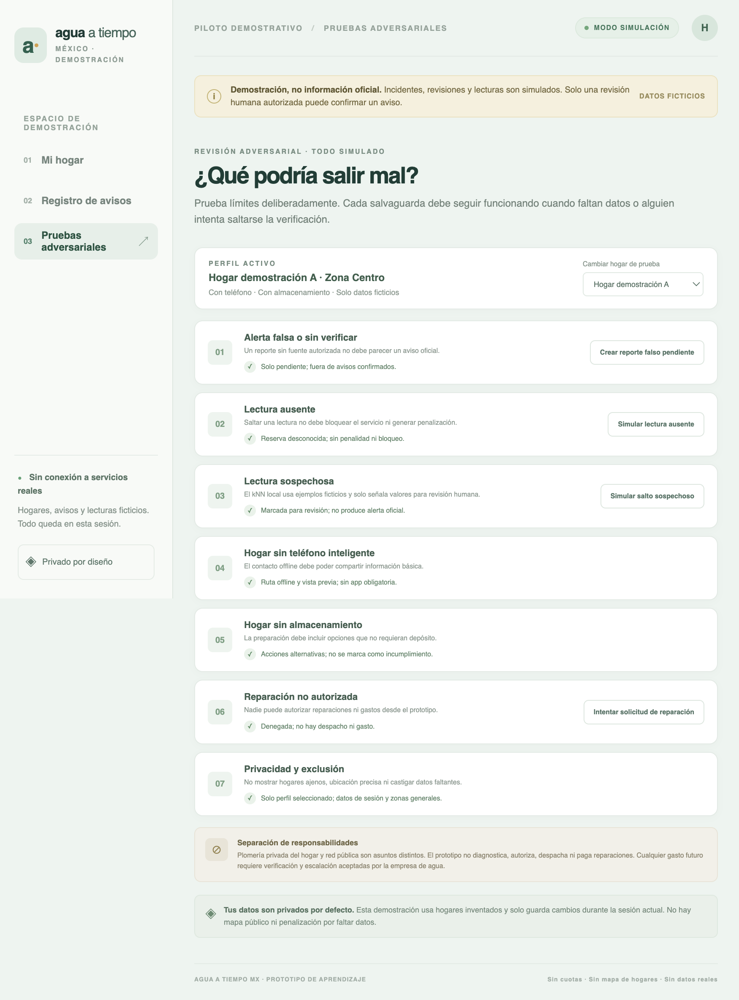
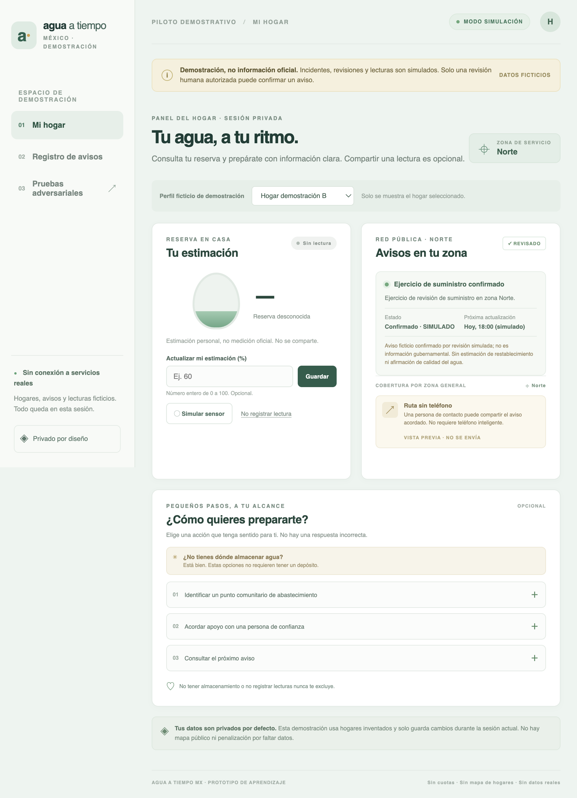

# Valeria — Screenshot-Based Persona Test

## Test provenance

This report records the genuine persona test completed by the project owner in a separate ChatGPT conversation. Valeria was described as a Mexico City resident with irregular water access, a limited budget, concerns about false alerts and preparation, and a need to include households without smartphones or water storage. The owner presented four application screenshots individually and supplied the observations below.

This was a synthetic persona exercise, not an interview with a real resident. This report does not add responses that were not included in the owner's notes. In particular, exact clicks/next actions and abandonment points were not recorded in the supplied results.

The screenshots below are genuine captures of the live first deployment, `https://week11-kohl.vercel.app/`. Screen 2 uses the captured household dashboard image, which shows the simulated sensor control; no distinct post-click sensor screenshot was available. A separate live no-phone/no-storage household capture is included as supplementary evidence.

## Screen 1 — Mi hogar

- **Understood:** reserve estimate and zone notices.
- **Positive:** appreciated the fictional-data label.
- **Confusion:** did not know how the 55% reserve was calculated.
- **Trust concern:** “no confirmed notices” could imply that no interruption would happen.
- **Requested:** clearer preparation instructions.
- **Next click / abandonment:** exact next click and abandonment point were not recorded.
- **Trust:** valued the simulation disclaimer, but the empty-notice wording risked overconfidence.

## Screen 2 — Sensor simulation

- **Understood:** the sensor reading was simulated.
- **Positive:** appreciated the privacy explanation.
- **Confusion:** questioned why the reserve changed from 55% to 48%, and wanted to know what a percentage means for her household.
- **Affordability concern:** did not want to purchase additional equipment.
- **Next click / abandonment:** exact next click and abandonment point were not recorded.
- **Trust:** clear simulation labeling helped, while the unexplained value change weakened confidence in the reading.

## Screen 3 — Incident register

- **Understood:** the distinction between pending and confirmed incidents.
- **Positive:** appreciated that statuses are explicit.
- **Most serious confusion:** the resident-facing screen displayed controls to confirm, correct, or reject incidents as an authorized reviewer.
- **Trust impact:** Valeria questioned why ordinary residents could access those controls; this reduced trust in the verification process.
- **Requested:** clearer indication of which notices affect her own zone.
- **Next click / abandonment:** exact next click and abandonment point were not recorded.
- **Trust:** the clear statuses helped, but exposing reviewer actions in the resident view was a critical credibility problem.

## Screen 4 — Adversarial tests

- **Positive:** appreciated protections against false alerts, exclusion, and unauthorized repairs.
- **Confusion:** “KNN local” was too technical.
- **Requested:** clearer plain-language explanations of offline access and alternatives without storage.
- **Trust concern:** green indicators were ambiguous—she could not tell whether they showed observed results or only expected behavior.
- **Next click / abandonment:** exact next click and abandonment point were not recorded.
- **Trust:** the safeguards were reassuring in principle, but the green indicators could overstate tested evidence.

## Additional accessibility scenario — no smartphone and no water storage

The owner said the persona scenario included people without smartphones or water storage and reported that Valeria wanted clearer explanations of offline access and storage alternatives. No additional exact quote, click, or abandonment observation was supplied for this individual screenshot; none is inferred here.

## Overall outcome and priority

Valeria would continue exploring the application but would not rely on it as her only source of water-interruption information.

**Highest-priority issue: reviewer authority was not separated from the resident-facing incident register.** Visible approval/correction/rejection controls implied that any resident could operate a verification workflow and undermined trust in incident confirmation. Fix this before polish: make resident information the default, expose reviewer controls only after an explicit, clearly labeled simulated reviewer-mode switch, and keep status transitions guarded by the reviewer role in application logic. The prototype has no real authentication, so the mode is educational and must not be described as actual authorization.

Other focused improvements: explain the basis and limits of reserve percentages, explain that a simulated sensor's six-point change is a fixed example rather than a real measurement, state that absence of a confirmed notice does not guarantee uninterrupted supply, use plain Spanish for offline/no-storage routes, and label adversarial indicators as expected behavior rather than completed test results.

## Changes made after the persona test

- The incident register now defaults to a resident view without review actions. Reviewer actions appear only in a separate, explicitly simulated reviewer mode. The application passes a resident role to the incident transition guard unless that mode is active; this is not authentication.
- Clarified that reserve percentages are manually estimated, approximate, and not liters; simulated sensor change is a fixed six-point example.
- Clarified that no currently confirmed notice is not a guarantee of uninterrupted water.
- Reworded no-phone and no-storage routes in plain Spanish, including no need to buy a tank.
- Replaced resident-facing “KNN” jargon with a plain-language description and changed adversarial indicators to say they describe expected behavior, not automated test results.
